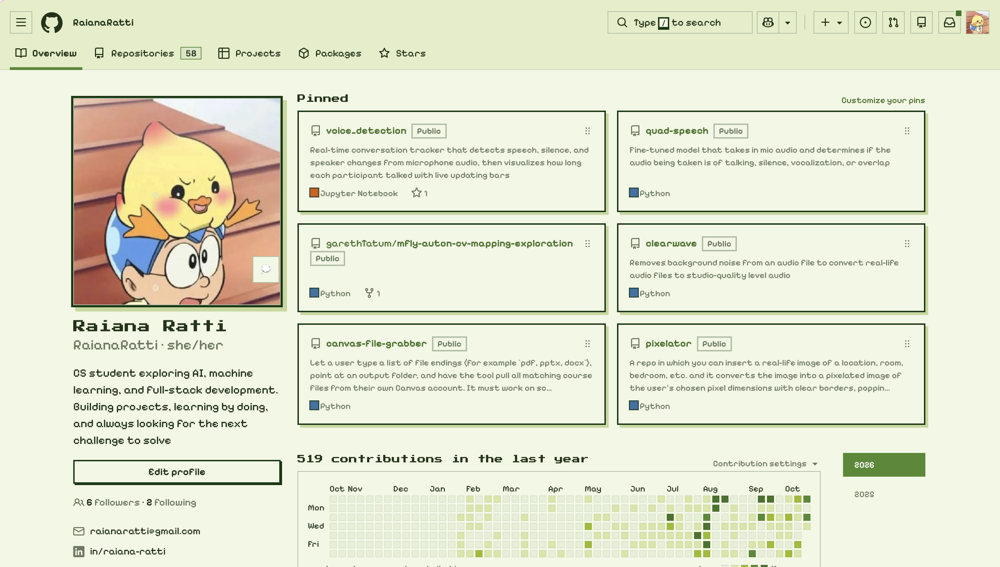
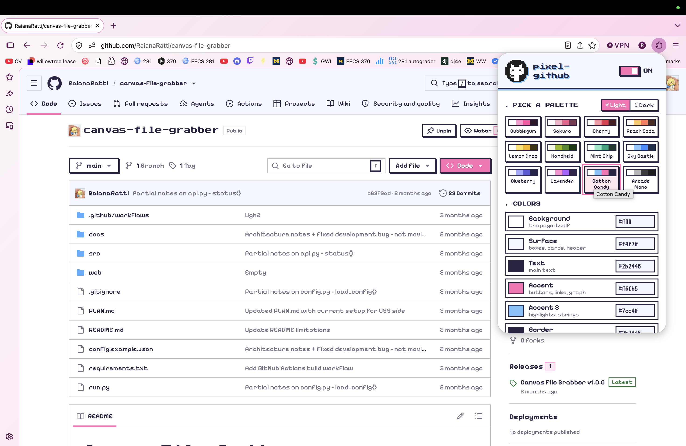

# pixel-github

A pixelated, video-game light theme for github.com: white and pink, square corners, chunky hard shadows,
arcade fonts, a pink contribution graph and a pixel cursor. Every color can be changed from the popup.

## Demo

# Handheld Theme - Home Page

# Bubblegum Theme - Repository Page


## Install

**Chrome / Edge / Brave / Arc**
1. Open `chrome://extensions`
2. Turn on **Developer mode** (top right)
3. Click **Load unpacked** and pick this folder
4. Pin the pixel Octocat icon in the toolbar

**Firefox** (140+)

Build the `.xpi` (output goes to `dist/`):

```sh
npx web-ext build --ignore-files dist README.md --overwrite-dest -a dist -n pixel-github-{version}.xpi
```

Regular Firefox only keeps add-ons that Mozilla has signed. Pick one of these:

- **Sign it (permanent, regular Firefox).** Get free API keys at
  https://addons.mozilla.org/developers/addon/api/key/ and run
  ```sh
  npx web-ext sign --channel=unlisted --api-key=YOUR_KEY --api-secret=YOUR_SECRET
  ```
  "Unlisted" means Mozilla signs it but it is **not** published on the add-ons store. The signed `.xpi` lands in
  `web-ext-artifacts/`. Drag it onto a Firefox window to install.
- **Firefox Developer Edition / Nightly (permanent, no signing).** Set `xpinstall.signatures.required` to `false`
  in `about:config`, then drag `dist/pixel-github-{version}.xpi` onto the window.
- **Quick try (until restart).** `about:debugging#/runtime/this-firefox` → **Load Temporary Add-on…** → pick the `.xpi`.

Bump `version` in `manifest.json` before signing again, because Mozilla won't sign the same version twice.

## Customize

Click the pixel Octocat icon:

- **Pick a palette**: Bubblegum, Sakura, Cherry, Peach Soda, Lemon Drop, Handheld, Mint Chip, Sky Castle, Blueberry, Lavender, Cotton Candy, Arcade Mono
- **Light / Dark**: every palette has a dark version. Flip the switch and the current palette swaps to it
  (your own custom colors get an automatic dark or light version).
- **Colors**: 7 colors (background, surface, text, accent, accent 2, border, shadow). Use the picker or type a hex.
  Every other shade (hover, soft tints, graph levels, syntax colors) is mixed from these.
- **Fonts**: Pixelify Sans / Silkscreen / Press Start 2P / VT323, or GitHub's normal fonts
- **Power-ups**: pixel cursor, chunky shadows, grid background, square avatars, CRT scanlines
- **ON/OFF** switch top right turns everything off instantly

Changes show up live on any open GitHub tab.

## Files

| File | What it does |
| --- | --- |
| `github.css` | The theme. Points GitHub's own color tokens at `--px-*` variables, then adds the pixel styling |
| `theme-data.js` | Presets, defaults, and the code that writes your settings onto the page as CSS variables |
| `content.js` | Runs on GitHub: loads fonts, forces light mode, live-updates |
| `popup/` | The settings panel |
| `fonts/` | Bundled pixel fonts (GitHub's security policy blocks Google Fonts) |

To tweak the styling by hand, edit `github.css` and hit the reload arrow on the extension card in `chrome://extensions`.

## Fonts

Pixelify Sans, Press Start 2P, Silkscreen and VT323 come from Google Fonts and are licensed under the
[SIL Open Font License 1.1](https://openfontlicense.org).
